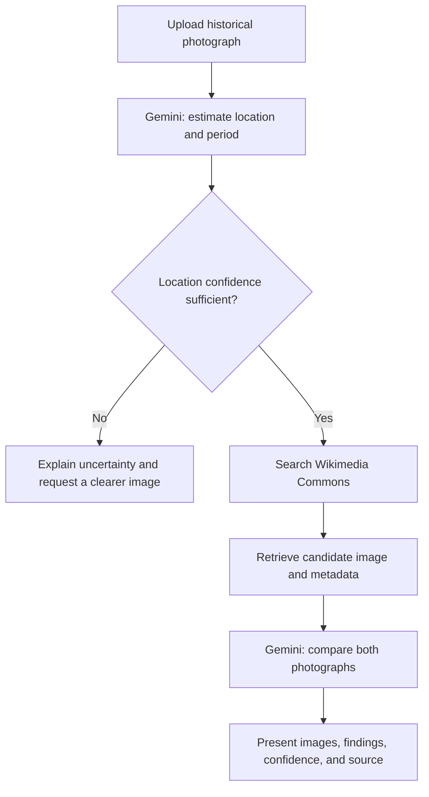

⏳ EpochTrek
A Living Archive — Explore the Past. Understand the Present.
An AI-assisted historical photo exploration app that connects a photograph from the past with a candidate image from an online archive, then summarizes the visible differences.

  
  

  
  
  
  

✦ Project Overview
EpochTrek is a Python and Streamlit application for exploring how recognizable places may have changed over time. A user uploads a historical photograph; the application uses Google Gemini to estimate the location and period, searches Wikimedia Commons for a candidate reference photograph, and asks Gemini to compare the two images for visible differences.
The project brings together multimodal AI, API integration, image retrieval, structured response parsing, and user-facing web development in one end-to-end workflow. It is designed as an exploratory tool—not as a substitute for verified historical research.
Try it: epochtrek.streamlit.app · Source code: github.com/breddyraghav/EpochTrek

✦ What It Does
Capability	Implementation
Historical image upload	Accepts JPG, JPEG, PNG, and WebP files through Streamlit's file uploader.
Visual location estimation	Sends the uploaded image to the configured Gemini model and requests structured location clues, confidence, and an estimated period.
Archive image discovery	Queries the Wikimedia Commons API for a candidate image and retrieves available source and licensing metadata.
Then-and-now presentation	Displays the uploaded photograph beside the selected archive candidate.
AI-assisted comparison	Asks Gemini to summarize visible differences and provide a same-location assessment and confidence notes.
Source transparency	Surfaces the archive source link and available attribution/license metadata so users can investigate the image independently.
Museum-inspired UI	Uses an editorial visual style, restrained colors, serif display typography, and a responsive layout.

✦ User Workflow
1. Upload — Choose a historical photograph showing a recognizable landmark, street, building, or public place.
2. Identify — Gemini analyzes visual evidence and returns a likely location, confidence level, clues, and an approximate period.
3. Search — EpochTrek queries Wikimedia Commons using the suggested search phrase, with a broader location query as a fallback.
4. Retrieve — The app downloads the selected candidate image and collects the source metadata that Wikimedia Commons provides.
5. Compare — Gemini receives both images and the location hypothesis, then generates a comparison focused on visible evidence.
6. Review — Inspect the two photographs, the location assessment, the summary, individual change descriptions, and the source details.

✦ Technology Stack
Technology	Role in EpochTrek
Python	Application logic, response handling, and orchestration.
Streamlit	Web interface, file upload, status feedback, and results layout.
Google Gen AI SDK (google-genai)	Sends image and text content to Gemini.
Google Gemini API	Location estimation and AI-assisted visual comparison. The configured model is gemini-3.5-flash-lite.
Wikimedia Commons API	Searches archive media and provides candidate-image URLs and available metadata.
Requests	Makes HTTP requests to Commons and downloads the selected image.
JSON / regular expressions	Parses structured model responses, including responses wrapped in Markdown code fences.
Git & GitHub	Source control, project history, and collaboration.
Streamlit Community Cloud	Hosts the public application.

✦ Repository Structure
EpochTrek/
├── .streamlit/
│   ├── config.toml               # Streamlit theme and server configuration
│   └── secrets.toml.example      # Safe template for local API-key setup
├── app.py                        # Main application, UI, APIs, and comparison flow
├── requirements.txt              # Python dependencies
├── test_gemini.py                # Gemini API diagnostic script
├── test_page.py                  # Minimal Streamlit rendering diagnostic
├── .gitignore                    # Excludes secrets, virtual environments, and local files
└── README.md                     # Project documentation
Create .streamlit/secrets.toml locally from the example when setting up the application. The real secrets file is deliberately excluded from version control.

✦ Run Locally
1. Prerequisites
- Python installed on your computer (Python 3.10 or newer is a practical baseline).
- Git.
- A Google Gemini API key with access to the configured model.
- Network access to the Gemini API and Wikimedia Commons.
Create or manage a key in Google AI Studio.
2. Clone the repository
git clone https://github.com/breddyraghav/EpochTrek.git
cd EpochTrek
3. Create a virtual environment
Windows — PowerShell
python -m venv .venv
.\.venv\Scripts\Activate.ps1
If PowerShell blocks environment activation, you can skip activation and call the environment's Python directly (shown in Step 4).
macOS / Linux
python3 -m venv .venv
source .venv/bin/activate
4. Install the dependencies
With the virtual environment activated:
python -m pip install --upgrade pip
python -m pip install -r requirements.txt
If you did not activate the environment on Windows, run:
.\.venv\Scripts\python.exe -m pip install --upgrade pip
.\.venv\Scripts\python.exe -m pip install -r requirements.txt
The project's requirements.txt currently includes:
streamlit>=1.42.0
google-genai>=1.0.0
requests>=2.31.0
5. Configure the Gemini API key
Copy .streamlit/secrets.toml.example to .streamlit/secrets.toml and edit the new file so it contains your key:
GEMINI_API_KEY = "YOUR_GEMINI_API_KEY"
The application reads GEMINI_API_KEY from Streamlit Secrets first, then falls back to an environment variable of the same name.
Keep credentials private: never paste a real key into app.py, commit it to Git, or include it in screenshots. The repository's .gitignore excludes .streamlit/secrets.toml; do not remove that protection.
6. Start the app
python -m streamlit run app.py
Open the local address printed by Streamlit—usually http://localhost:8501.
✦ Deployment
The public app is deployed at epochtrek.streamlit.app.
To deploy or connect your own instance using Streamlit Community Cloud:
1. Sign in with GitHub and select the breddyraghav/EpochTrek repository.
2. Choose the main branch and set the entry-point file to app.py.
3. In the app's Secrets settings, add the following TOML configuration with your real key:
   GEMINI_API_KEY = "YOUR_GEMINI_API_KEY"
4. Deploy the app and review the build logs if startup fails.
5. After pushing future changes to the configured branch, wait for the deployment to complete and test the live app.
Do not commit Streamlit secrets to make deployment work; configure them in the hosting platform instead.
✦ Configuration and Error Handling
- The main app is configured for a wide Streamlit layout and applies its museum-inspired design through custom CSS.
- Image identification and change analysis request JSON output from Gemini. The response parser also tolerates optional Markdown fences.
- If the location cannot be identified with enough confidence, the workflow stops rather than presenting a speculative comparison as certain.
- If Commons returns no usable candidate image or a network request fails, the app displays an error instead of completing a misleading comparison.
- The app relies on third-party services, so API availability, quotas, permissions, network connectivity, and model access affect runtime behavior.
✦ Responsible Interpretation and Limitations
EpochTrek is an educational and exploratory project. Its results should be interpreted carefully:
- Location estimates are hypotheses. Visual clues and AI confidence are not independent historical verification.
- A candidate is not guaranteed to be the same place. Search relevance does not prove that two photographs show the same location or viewpoint.
- “Now” may not mean today. The selected Commons image may have been captured at an earlier date; check its metadata and source page.
- Change summaries can be wrong or incomplete. Gemini may miss details, mistake perspective differences for changes, or produce inaccurate interpretations.
- Metadata may be incomplete. Dates, author details, descriptions, and license fields depend on what is available in the source record.
- Image rights still matter. Review the original Commons file page and comply with its stated license and attribution requirements before reusing an image.
Verify important claims against reliable sources before using the output in academic, journalistic, or professional work.
✦ Development and Diagnostics
The repository includes two lightweight diagnostic scripts:
- test_gemini.py checks whether the local Gemini credentials work with the model candidates defined in that script.
- test_page.py is a minimal Streamlit page used to check whether the interface renders.
These are diagnostic utilities, not a comprehensive automated test suite. Run the main application with a configured API key to test the complete image-upload, identification, retrieval, and comparison path.
✦ Roadmap
Possible future improvements include:
- Let users review and choose from multiple Commons candidates instead of relying on the first result.
- Provide better location verification before comparison.
- Add an interactive before-and-after slider.
- Improve metadata presentation and date/source validation.
- Add downloadable comparison reports and clearer source attribution.
- Expand automated tests for API failures, uncertain locations, unsupported image types, and incomplete metadata.
These are potential enhancements, not claims about current functionality.
✦ Collaboration
Contributions and constructive feedback are welcome, especially in image retrieval, location verification, interface accessibility, testing, documentation, and responsible AI presentation.
1. Fork the repository.
2. Create a focused branch for your change.
3. Make the change and test it locally.
4. Commit with a descriptive message.
5. Open a pull request explaining the motivation, implementation, and testing performed.
For larger changes, open an issue first to discuss the proposed approach. Do not include API keys, private credentials, or unrelated generated files in a contribution.
✦ Author
B. Reddy Raghav — Engineering student building practical software projects with Python and AI APIs.
- GitHub: @breddyraghav
- Project repository: breddyraghav/EpochTrek
- Live application: epochtrek.streamlit.app
✦ License
No license file is currently included in the repository. Unless a license is added, others should not assume they have permission to redistribute or reuse the project's source code. Add an appropriate license if you intend to permit reuse.

EPOCHTREK
Every photograph is a fragment of history. Explore the story behind the place.
Launch the app · Read the source

